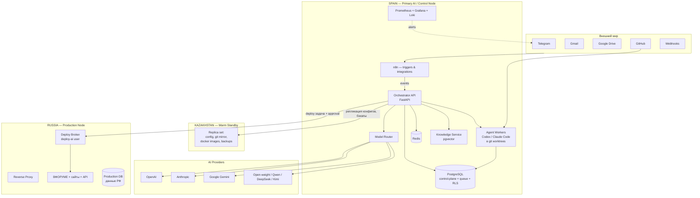
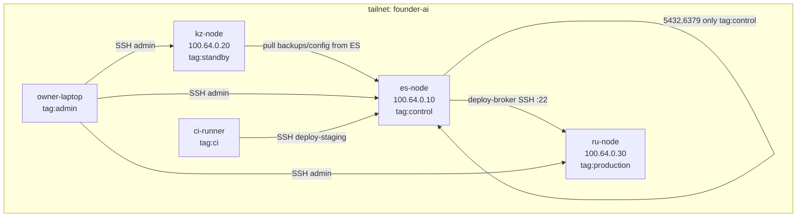

# ARCHITECTURE.md

## 1. Executive architecture summary

Founder AI OS — производственная система, а не чат с агентами. Единый контур:

```
Событие → Задача → Декомпозиция → Исполнитель → Инструменты → Результат
→ Независимая проверка → Acceptance test → Approval → Следующий workflow → KPI → Audit log
```

Ядро — **orchestrator service** (FastAPI, Python): владеет состоянием задач, агентов, permissions, аудитом, маршрутизацией моделей и approvals. Вокруг него:

- **PostgreSQL** — единственный source of truth (данные, очередь задач через `SKIP LOCKED`, audit log).
- **Redis** — кэш, rate limits, ephemeral state. Не source of truth.
- **n8n** — только event triggers и интеграции (входящие webhook, почта, календарь). Не хранит бизнес-состояния.
- **Model Router** — единая точка вызова LLM; провайдеры взаимозаменяемы.
- **AI-агенты** (Codex, Claude Code, др.) — stateless исполнители, запускаемые orchestrator'ом в изолированных git worktrees.
- **Knowledge layer** — ingestion → chunking → embeddings (pgvector) → retrieval с фильтрацией по правам роли.
- **Deploy broker** — единственный путь к RU production.

Система multi-tenant с рождения: `tenant_id` + PostgreSQL Row Level Security на каждой бизнес-таблице.

## 2. Общая архитектура (Mermaid)



## 3. Deployment topology: Spain / Kazakhstan / Russia

### Spain — PRIMARY AI NODE
| Компонент | Назначение |
|---|---|
| Orchestrator API | состояние задач, агентов, approvals, аудит |
| Model Router | маршрутизация LLM-вызовов, cost tracking |
| Agent Workers | Codex CLI, Claude Code CLI в worktrees |
| n8n | triggers, интеграции |
| PostgreSQL | control-plane, очередь, аудит |
| Redis | кэш, rate limit |
| Knowledge service | pgvector retrieval |
| Monitoring | Prometheus, Loki, Grafana, Alertmanager |
| restic | бэкапы в off-provider storage |

Требования к VPS: 4 vCPU / 8–16 GB RAM / 160 GB SSD (Hetzner/другой EU-провайдер, ~€15–30/мес).

### Kazakhstan — SECONDARY NODE (warm standby)
Получает непрерывно:
- git-зеркала всех репозиториев (push в 2 remote);
- PostgreSQL WAL-архив + nightly base backup (restic);
- docker images (registry mirror или `docker save` по расписанию);
- конфигурацию (SOPS-зашифрованную, ключ age у владельца + escrow);
- IaC (те же install-скрипты, что и для Spain).

Не держит живой трафик. Процедура активации — docs/DISASTER_RECOVERY.md §4. RTO для control-plane: ≤ 4 часа при отработанной процедуре.

### Russia — PRODUCTION NODE
- Только runtime для российских пользователей: ВФОРУМЕ, сайты, API, production DB (данные, которые по 152-ФЗ должны быть в РФ, — физически здесь).
- Никаких LLM-клиентов, никаких unrestricted shells для AI.
- Вход: только Tailscale + reverse proxy.
- Deploy — исключительно через deploy broker (см. docs/SECURITY.md §6).

## 4. Network architecture: Tailscale vs native WireGuard

| Критерий | Tailscale | Native WireGuard |
|---|---|---|
| Безопасность | WireGuard-транспорт + SSO-идентичность узлов, ACL как код | Тот же транспорт, но ключи и ACL — руками |
| Сложность | Низкая: установка за минуты | Средняя: ручная раздача ключей, peer-конфиги N×N |
| Управление ключами | Автоматическая ротация, привязка к identity | Полностью ручная; компрометация ключа = ручная ротация на всех узлах |
| ACL | Централизованные, group/tag-based, в Git (infra as code) | Только firewall поверх — iptables/nftables |
| Disaster recovery | Переустановка узла = tailscale up + auth key | Восстановление = восстановление конфигов и ключей вручную |
| Независимость от стороннего control plane | **Зависимость** (coordination server Tailscale). Смягчается: coordination нужен только для установления соединения и ротации ключей, не для трафика (direct P2P) | Полная независимость |
| Обслуживание | Минимальное | Растёт с числом узлов |

**Решение для MVP: Tailscale.**

Обоснование: 3 узла + ноутбук владельца + CI; скорость развёртывания и качество ACL важнее идеологической независимости. Риск зависимости от control plane реальный, но ограниченный: при недоступности coordination server уже установленные P2P-соединения продолжают работать; риск — невозможность добавить новый узел.

**Миграционный путь (v1.1):** self-hosted Headscale как control plane — тот же клиент, своя координация, размещается на KZ-node. Это закрывает и vendor lock-in, и DR-сценарий.

### Схема сети



ACL-принципы:
- `tag:production` принимает соединения только от deploy-broker (ES) по порту 22 и от monitoring (ES) по 9100/9113.
- `tag:standby` — только исходящие к ES (pull-модель: KZ сам забирает бэкапы; ES не имеет права писать в KZ).
- Никакой узел tailnet не exposed в публичный интернет, кроме RU reverse proxy (80/443) и Spain API (443, за прокси с auth).

## 5. Docker Compose architecture (Spain)

Один `docker-compose.yml` на узел, профили для необязательных сервисов. Сервисы:

| Сервис | Образ | Назначение |
|---|---|---|
| `postgres` | postgres:16 + pgvector | control-plane, queue, knowledge |
| `redis` | redis:7 | кэш, rate limits |
| `orchestrator` | свой образ | FastAPI backend |
| `model-router` | свой образ | LLM gateway + cost metering |
| `knowledge` | свой образ | ingestion/retrieval |
| `n8n` | n8nio/n8n | triggers/интеграции |
| `agent-runner` | свой образ | исполнитель Codex/Claude CLI в worktrees (docker-outside-docker через контролируемый socket proxy) |
| `deploy-broker` | свой образ | единственный клиент SSH к RU |
| `prometheus`, `grafana`, `loki`, `promtail` | официальные | observability |
| `node-exporter`, `cadvisor` | официальные | метрики хоста |
| `restic` | restic/restic | бэкапы по cron |
| `caddy` | caddy:2 | TLS, reverse proxy, auth для admin-интерфейсов |

Файл: [infra/docker-compose.yml](../infra/docker-compose.yml).

## 6. Environment strategy

| Env | Где | Данные | Доступ |
|---|---|---|---|
| dev | ноутбуки / worktrees на Spain | синтетические | разработчики и AI-агенты |
| test | CI runner на Spain | синтетические + fixtures | CI |
| staging | Spain, отдельный compose-проект, отдельная БД | обезличенная копия (скрипт anonymize) | AI-агенты через deploy-broker, владелец |
| production | RU (продукты), Spain (control-plane) | реальные | минимальный, через approval |

Правила:
- Один и тот же образ проходит dev → test → staging → production без пересборки (build once, promote by tag).
- Миграции БД применяются на staging первыми, затем на production через ту же команду.
- Секреты разделены по env: отдельные age-получатели в SOPS для staging и production.

## 7. Model Router design

Единственный способ вызвать LLM в системе — через Model Router. Прямые вызовы API из агентов запрещены политикой.

### Вход решения

```json
{
  "task_type": "backend_coding | frontend_coding | research | classification | writing | review | decision_analysis",
  "quality_required": "low | standard | high | critical",
  "privacy_level": "public | internal | confidential",
  "latency_budget_ms": 30000,
  "context_size_estimate": 45000,
  "max_cost_usd": 0.50,
  "tenant_id": "..."
}
```

### Логика выбора (по приоритету)

1. **Privacy filter.** `confidential` → только провайдеры с zero-retention соглашением или open-weight локально. Данные РФ-пользователей — не покидают разрешённый контур.
2. **Context filter.** Отсекает модели с недостаточным окном.
3. **Availability.** Живой health-check + circuit breaker per provider.
4. **Score.** `score = w1·eval_score(task_type, model) + w2·(1/price) + w3·(1/latency)` — веса в конфиге, `eval_score` из таблицы `model_runs` (см. раздел 8).
5. **Fallback chain.** primary → fallback по списку, максимум 2 ретрая с exponential backoff.

### Реестр моделей

`models/registry.yaml` — единственное место, где описаны модели: id, провайдер, endpoint, цены, окно контекста, лимиты, privacy class. Добавление Qwen/DeepSeek/Kimi = новая запись в реестре + адаптер интерфейса провайдера, без изменения бизнес-логики.

### Актуальные цены (проверено 2026-11-05, на 1M токенов input/output)

| Класс | Модель | Цена | Применение |
|---|---|---|---|
| Frontier | Claude Fable 5.1, GPT-6 Astra | $10 / $50 | COMPETE-арбитраж, критичные решения — редко |
| Strong | Claude Opus 5.5, GPT-5.6 Sol | $4 / $20 | сложная архитектура, review критичного кода |
| Mid | Claude Sonnet 5.5, GPT-6.1 Sol, Gemini 4 Argon* | $2 / $10 | основной coding/research workhorse |
| Fast | Gemini 3.8 Flash** | $0.75 / $3.75 | drafts, summarization |
| Cheap | Claude Haiku 5.5, GPT-6 Luna, Gemini 3.5 Flash-Lite | $0.10–0.30 / $0.50–2.50 | классификация, routing, extraction |

\* Argon: $2/$10 до 30.11.2026, с 01.12.2026 — $4/$20. В смете считаем по цене после повышения.
\** Flash: с 01.01.2027 — $1.50/$7.50.

Правило из ТЗ зашито в policy: задача типа `classification` никогда не получает модель класса выше `cheap`.

## 8. Model evaluation / internal arena

Каждый LLM-вызов пишется в `model_runs`: task_type, model, cost, latency, success, downstream review score, acceptance result, human correction flag. Раз в неделю агрегация → таблица эффективности по (task_type × model), которую читает router.

Режим COMPETE (см. TASK_PROTOCOL.md) одновременно является источником arena-данных: два агента решают одну проблему независимо, auditor оценивает оба решения по рубрике — результат ложится в `model_runs.review_score`.

## 9. Knowledge layer

```
sources (GDrive, docs, transcripts, CRM, git)
  → ingestion workers (connectors)
  → parsing (text/markdown/pdf)
  → metadata (tenant_id, acl_tags, source, date)
  → chunking (semantic, ~500 токенов, overlap 10%)
  → embeddings (pgvector, HNSW index)
  → retrieval: WHERE tenant_id = :t AND acl_tags <@ :role_tags
```

**Правило:** retrieval-запрос всегда несёт `role_tags` вызывающего агента; фильтрация на уровне SQL, а не prompt. Общего unrestricted vector store не существует архитектурно — таблица `knowledge_chunks` имеет NOT NULL `acl_tags`, и политика RLS режет строки до similarity search.

## 10. Repository structure & Git architecture

**Решение: monorepo `founder-ai-os` + отдельные репозитории `vforume` и `infrastructure`.**

- OPTION A (всё в одном monorepo) — отвергнут: ВФОРУМЕ — продукт со своим релизным циклом и потенциально другой командой; infrastructure содержит чувствительную конфигурацию с отдельным контуром доступа.
- OPTION B (всё раздельно) — отвергнут: shared schemas/packages, атомарные изменения протоколов, единый CI — всё это сильно дешевле в monorepo.
- TRADEOFF принятого варианта: 3 репозитория вместо 1 — нужна синхронизация версий `packages/schemas` между `founder-ai-os` и `vforume`. Решается публикацией versioned package и dependabot.

### Параллельная AI-разработка

- Каждая задача → ветка `task/<TASK_ID>-<slug>` → отдельный `git worktree` в `/srv/worktrees/<TASK_ID>/`.
- Codex и Claude никогда не разделяют рабочую копию.
- Merge — только через MR с зелёным CI и cross-review (см. TASK_PROTOCOL.md).
- `main` защищён: push запрещён всем, включая владельца, кроме merge через CI.
