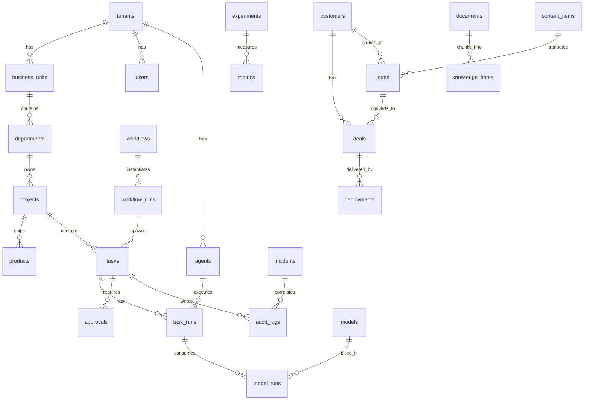

# DATABASE.md — PostgreSQL ER-модель

## Принципы

1. PostgreSQL 16 — единственный source of truth.
2. **Multi-tenant:** каждая бизнес-таблица имеет `tenant_id uuid NOT NULL REFERENCES tenants(id)` + Row Level Security. Политика: `USING (tenant_id = current_setting('app.tenant_id')::uuid)`. Backend устанавливает `app.tenant_id` на каждое соединение из аутентифицированного контекста. Superuser для приложения не используется; миграции — отдельная роль `migrator`.
3. Миграции — Alembic (Python), одна миграция = одна логическая операция, каждая с `downgrade()`.
4. Аудит и логи стоимости — append-only (REVOKE UPDATE, DELETE).
5. Идентификаторы — `uuid` (gen_random_uuid), время — `timestamptz`.

## ER-диаграмма (ядро)

## Таблицы

### Ядро и multi-tenant

**tenants** — компания-арендатор.
Поля: `id, name, slug, status, plan, created_at`.
Индексы: unique(slug).

**users** — люди.
Поля: `id, tenant_id, email, full_name, role_id, status, last_login_at`.
Индексы: unique(tenant_id, email).

**roles / permissions** — RBAC. `roles(id, tenant_id, name, description)`; `permissions(id, code, description)`; связующая `role_permissions(role_id, permission_id)`. Коды permissions — строки вида `deploy.production`, `approve.payment`, `knowledge.read.confidential`.

**business_units** — пять контуров (Личный бренд, Проявленность, Ярдники, ВФОРУМЕ, R&D).
Поля: `id, tenant_id, name, code, owner_user_id`.

**departments** — отделы внутри business unit (Development, Sales, Content, Product, Operations, Client Success, R&D).
Поля: `id, tenant_id, business_unit_id, name, kpi_definition jsonb`.

**projects / products** — `projects(id, tenant_id, department_id, name, status, repo_url)`; `products(id, tenant_id, project_id, name, status, metric_of_success)`.

### Задачи и агенты

**tasks** — см. TASK_PROTOCOL.md; зеркалит JSON Schema.
Поля: `id, tenant_id, project_id, department_id, workflow_run_id, goal, why, input jsonb, context jsonb, expected_output jsonb, acceptance_criteria jsonb, tools_allowed text[], permissions text[], primary_model, fallback_model, budget_usd numeric, deadline timestamptz, reviewer_agent_id, retry_policy jsonb, escalation_policy jsonb, status task_status, parent_task_id, created_by, created_at, updated_at`.
Индексы: `(tenant_id, status)`, `(status) WHERE status = 'queued'` — для SKIP LOCKED-очереди, `(project_id, status)`, partial index по `deadline` для активных.
`task_status` — enum: `created, queued, running, blocked, review, rework, approved, failed, completed, cancelled`.

**task_runs** — один запуск агента по задаче (попытка).
Поля: `id, tenant_id, task_id, agent_id, mode (PAIR|PARALLEL|REVIEW|COMPETE|SOLO), started_at, finished_at, status, report jsonb, cost_usd, tokens_in, tokens_out, worktree_path, branch, commit_sha`.
Индексы: `(task_id, created_at)`, `(agent_id, started_at)`.

**agents** — ИИ-сотрудник (экземпляр роли).
Поля: `id, tenant_id, department_id, role_id, name, system_instruction_ref, tools text[], permissions text[], model_policy jsonb, budget_monthly_usd, kpi jsonb, reviewer_agent_id, escalation_rule jsonb, status`.

**agent_roles** — справочник ролей (AI CTO, Codex Developer…).
Поля: `id, code, name, goal, input_schema jsonb, output_schema jsonb, default_tools text[], default_kpi jsonb`.

**models** — реестр LLM.
Поля: `id, provider, model_name, input_price_usd, output_price_usd, context_window, privacy_class, status, endpoint_config jsonb`.

**model_runs** — каждый вызов LLM (пишется только router'ом).
Поля: `id, tenant_id, task_run_id, model_id, task_type, tokens_in, tokens_out, cost_usd, latency_ms, success bool, review_score numeric, acceptance_result, human_correction bool, created_at`.
Индексы: `(task_type, model_id, created_at)` — для arena-агрегации, `(tenant_id, created_at)` — для cost reporting.
Append-only.

**workflows / workflow_runs** — `workflows(id, tenant_id, code, name, definition jsonb /* DAG шагов */, version)`; `workflow_runs(id, tenant_id, workflow_id, status, started_by, context jsonb, started_at, finished_at)`.

### CRM и продажи

**customers** — `id, tenant_id, name, contacts jsonb, segment, status`.
**leads** — `id, tenant_id, customer_id, source, content_item_id /* атрибуция */, status, qualification jsonb, next_contact_at, probability`.
**deals** — `id, tenant_id, customer_id, lead_id, amount, currency, status (open|won|lost), lost_reason, closed_at`.
Индексы: `leads(tenant_id, status, next_contact_at)`, `deals(tenant_id, status)`.

### Контент, знания, решения

**content_items** — `id, tenant_id, department_id, type, title, body_ref, status, published_at, utm jsonb`.
**documents** — `id, tenant_id, source_connector, external_id, title, acl_tags text[], uri, ingested_at`.
**knowledge_items** — чанки: `id, tenant_id, document_id, chunk_index, content, embedding vector(1536), acl_tags text[] NOT NULL`.
Индексы: HNSW по `embedding`, `(tenant_id) ` + RLS по acl_tags (через дополнительную политику и GIN по acl_tags).
**decisions** — `id, tenant_id, author (agent|user), question, options jsonb, assumptions jsonb, probabilities jsonb, expected_value jsonb, chosen, evidence_that_changes jsonb, created_at` — журнал Decision Science layer.
**approvals** — `id, tenant_id, task_id, type, payload jsonb, status (pending|approved|rejected|expired), requested_at, decided_by, decided_at, expires_at, channel_message_id`. См. SECURITY.md §5.

### Эксперименты, метрики, эксплуатация

**experiments** — R&D-воронка: `id, tenant_id, idea, hypothesis, kill_criteria jsonb, stage, unit_economics jsonb, verdict (scale|kill|pivot), created_at, closed_at`.
**metrics** — `id, tenant_id, entity_type, entity_id, metric_code, value numeric, measured_at`. Индекс `(entity_type, entity_id, metric_code, measured_at)`.
**deployments** — `id, tenant_id, project_id, env, commit_sha, image_tag, status, deployed_by (agent|user|broker), approved_by, healthcheck_result, rollback_of, created_at`.
**incidents** — `id, tenant_id, severity, title, status, detected_by, root_cause, resolved_at`.
**audit_logs** — `id, tenant_id, actor_type, actor_id, action, entity_type, entity_id, payload jsonb, prev_hash, hash, created_at`. Hash-chain: `hash = sha256(prev_hash || canonical(payload))`. Append-only. Индекс `(tenant_id, entity_type, entity_id, created_at)`.
**cost_logs** — `id, tenant_id, entity_type (model_run|task|workflow|department|project), entity_id, cost_type (ai|infra|human_estimate), amount_usd, business_value_usd, created_at`. Индекс `(tenant_id, entity_type, entity_id, created_at)`.

## Финансовый контур (добавлено по §49–55 дополнения; см. FINANCE.md)

**financial_transactions** — единая классификация денег. Поля: `id, tenant_id, business_unit_id, project_id, line_item (revenue|cogs|ai_cost|contractors|human_labour|marketing|sales|infrastructure), direction (inflow|outflow), amount, currency, occurred_at, source (manual|import|auto_cost_logs), external_ref`.
Индексы: `(tenant_id, business_unit_id, occurred_at)`, `(line_item)`. План/факт/forecast — отдельное поле `scenario (plan|fact|forecast)`.

**cash_flow_forecast** — 13-недельный rolling forecast: `id, tenant_id, week_start, scenario (base|negative|upside), line_item, amount, computed_at`. Пересчёт еженедельно workflow'ом.

**project_economics** — карточка экономики проекта: `project_id (PK/FK), revenue_potential, direct_cost, ai_cost, human_hours, founder_hours, expected_margin, actual_margin, payback_weeks, strategic_value, probability_of_success, kill_criteria jsonb, kill_rule_status, updated_at`.

**time_entries** — Time & Attention Ledger: `id, tenant_id, project_id, person_type (founder|top_manager|human|ai_run), hours, source (auto_approval|weekly_poll|manual), occurred_on`. Founder hours по approvals считаются автоматически (timestamps), остальное — еженедельный опрос.

**customer_insights** — см. REVENUE_SYSTEM.md §1: `id, tenant_id, source, segment, problem, frequency, severity, current_solution, willingness_to_pay, evidence_level (single_case|few_cases|pattern), created_at`. Индекс `(tenant_id, segment, evidence_level)`.

**positioning** — карточка продукта: `product_id (PK/FK), icp, jtbd, core_problem, promise, proof, differentiation, alternatives, reasons_to_believe, value_metric, price_logic, status, updated_at`.

**deals.value_hypothesis jsonb** — расширение deals: `current_cost_of_problem, lost_revenue, human_hours, risk, expected_value, payback` (value selling, §61). Предложение клиенту без заполненной value_hypothesis блокируется workflow'ом.

## Что осознанно НЕ делаем в БД v1

- Нет отдельной БД на tenant (shared schema + RLS; dedicated schema/БД — опция для enterprise-tenant позже, слой миграций это допускает).
- Нет event sourcing: аудит — append-only лог, но состояние — обычные таблицы. Event sourcing — двойная стоимость записи без пользы на MVP.
- Нет отдельного vector store (Qdrant/Weaviate): pgvector закрывает объёмы MVP (до единиц миллионов чанков) и убирает целый сервис из эксплуатации.
- Нет банковских интеграций: financial_transactions на MVP наполняются импортом/ручным вводом; автоматическая строка — только AI costs из cost_logs.
